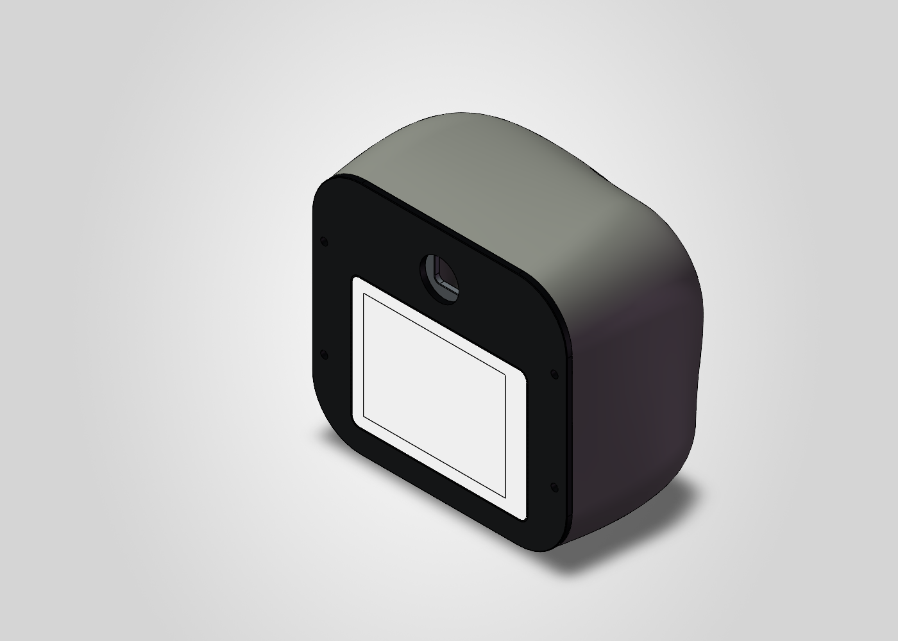

# 模块化机器人机械设计与 CAD 自动化

以可维护、可换装的机器人模块为目标，完成参数化机构设计、SolidWorks 自动建模、模块接口检查及载荷筛选。设计记录始于 2026 年 9 月。

## 已有产出

- [Python 自动建模与装配脚本](scripts/)，包含参数化零件、装配、工程图和几何检查。
- [结构说明](docs/)，覆盖关节、载荷转移、储物舱导轨与锁止、头部与相机安装。
- [参数与计算表](data/)和[历史检查记录](validation/)，保留质量、力矩、安装空间和公差假设。
- [H12 / H13 原生零件样例](parts/)，展示相机接口承架与四点绝缘托架的设计。

## 使用

普通 Python 可查看和运行独立计算脚本，例如 `python scripts/calculate_cargo_rail_screen.py`。SolidWorks 自动化需要 Windows、SolidWorks 和 Python COM 环境，主接口位于 `scripts/sw_core.py`。完整装配还引用外购件和其他设计版本；本仓库提供部分原生样件和自有生成程序，供应商原生模型未整体再分发。

当前结果属于结构候选、计算筛选与 CAD 检查。材料、工况和边界假设写在对应记录中，不将几何可装配直接等同于强度、寿命或实物性能合格。此次归档没有运行 SolidWorks 或实物试验。
