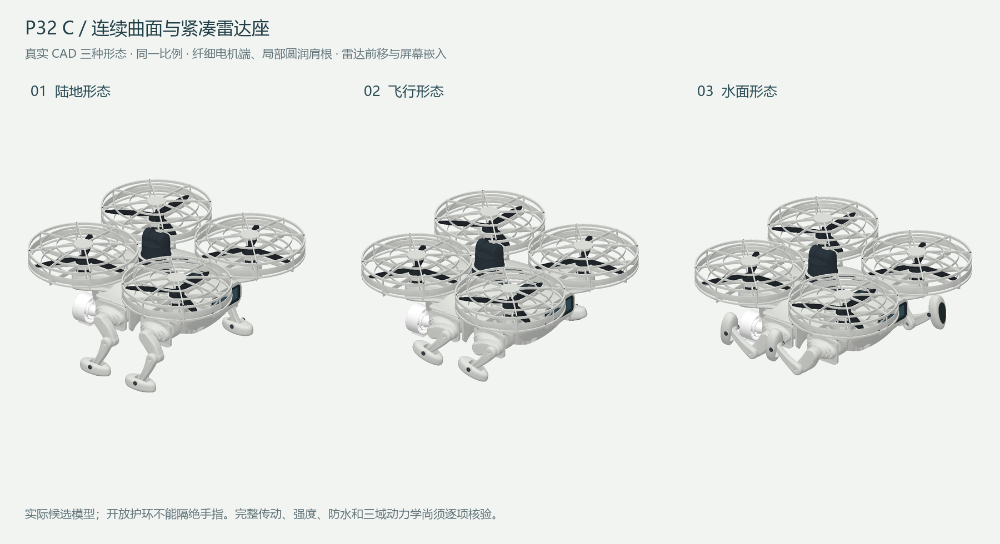

# P32C 海陆空机械宠物进展

本次将截至 2026-11-05 的现有设计与检查整理到展示页，未恢复已暂停的 CAD 或仿真任务。

设计目标是在同一机体保留陆地、水面和飞行机构，通过主动关节切换；早期模块接口与自动建模代码继续保留。当前 P32C 为纤细支撑、连续曲面主舱、完整护环和紧凑雷达座的候选。

- 已有陆地、水面、飞行三态原生装配与扫掠检查记录；不同形态的图片采用同一比例。
- 当前几何及分配质量预算约 6.2207 kg，传动和最终电装仍未闭合；它不是实测整机重量。
- 已进行质量/重心、排水包络、空中/水面/陆地动力学以及支撑转移、抬脚净空的有限控制实验。
- 抬脚平台实验的稳态前进回归约 5.6 mm/s，仍远低于 0.1 m/s 目标；理想耦合和接触近似不能替代最终传动或实机步态。
- 整机传动、强度、防水与实际续航仍需逐项闭合；开放护环不构成手指隔离证明。

完整历史 CAD 与记录在作者私有 mechanical-pet-design-records 中分版本保存。当前公开仓库继续提供自有自动化程序、部分早期零件和本概览，不将 P32C 图像当作已完成的量产设计。
